# Diagramas de arquitectura de RedNexus

Diagramas del documento (DOC-01), hechos a partir del código de los tres repos. Las fuentes están en **PlantUML**, en [diagramas/](diagramas): son texto, así que se revisan en los PR como cualquier otro cambio. Las imágenes ya generadas están en [img/](img), listas para pegar en Word o en la presentación.

**Convenciones:** azul oscuro = persona, azul = nuestro sistema o contenedor, gris = sistema externo. **Borde o línea punteada = previsto, todavía no construido.** Los C4 usan la notación estándar de [C4-PlantUML](https://github.com/plantuml-stdlib/C4-PlantUML).

## Cómo editar y regenerar

1. Edita el `.puml` en [diagramas/](diagramas).
2. Genera la imagen con una de estas opciones:
   - **VS Code:** extensión *PlantUML* (jebbs.plantuml), `Alt+D` para la vista previa y *Export Current Diagram* para el PNG.
   - **Sin instalar nada:** pega el contenido en https://www.plantuml.com/plantuml y descarga el PNG.
   - **Terminal** (requiere Java y Graphviz), desde la raíz del repo:

     ```bash
     java -jar plantuml.jar -charset UTF-8 -tpng -o ../img docs/arquitectura/diagramas/*.puml
     ```
3. Sube el `.puml` y el `.png` en el mismo PR.

| # | Diagrama | Fuente | Estado de lo que muestra |
| --- | --- | --- | --- |
| 1 | C4 nivel 1: contexto | [01-c4-contexto.puml](diagramas/01-c4-contexto.puml) | Construido |
| 2 | C4 nivel 2: contenedores | [02-c4-contenedores.puml](diagramas/02-c4-contenedores.puml) | Construido, salvo whisper.cpp y el volumen de audios |
| 3 | C4 nivel 3: componentes de la API y el worker | [03-c4-componentes.puml](diagramas/03-c4-componentes.puml) | Construido |
| 4 | 4+1 vista física: despliegue local (k3d / minikube) | [04-despliegue-local.puml](diagramas/04-despliegue-local.puml) | Construido |
| 5 | 4+1 vista física: ambiente de demo y CI/CD | [05-despliegue-demo-cicd.puml](diagramas/05-despliegue-demo-cicd.puml) | CI construido; el resto previsto (PL-01 a PL-07) |
| 6 | Modelo entidad-relación | [06-modelo-entidad-relacion.puml](diagramas/06-modelo-entidad-relacion.puml) | Construido (migraciones de Prisma) |
| 7 | Casos de uso | [07-casos-de-uso.puml](diagramas/07-casos-de-uso.puml) | Construido, salvo nota de voz |
| 8 | Secuencia: publicar solicitud y emparejar con IA | [08-secuencia-solicitud-emparejamiento.puml](diagramas/08-secuencia-solicitud-emparejamiento.puml) | Construido |
| 9 | Secuencia: aceptar la ayuda y calificar | [09-secuencia-aceptar-calificar.puml](diagramas/09-secuencia-aceptar-calificar.puml) | Construido |
| 10 | Actividades: algoritmo de emparejamiento | [10-actividades-emparejamiento.puml](diagramas/10-actividades-emparejamiento.puml) | Construido |
| 11 | Estados de la solicitud y del candidato | [11-estados.puml](diagramas/11-estados.puml) | Construido |

---

## 1. C4 nivel 1: contexto del sistema

Quién usa RedNexus y con qué sistemas se relaciona.

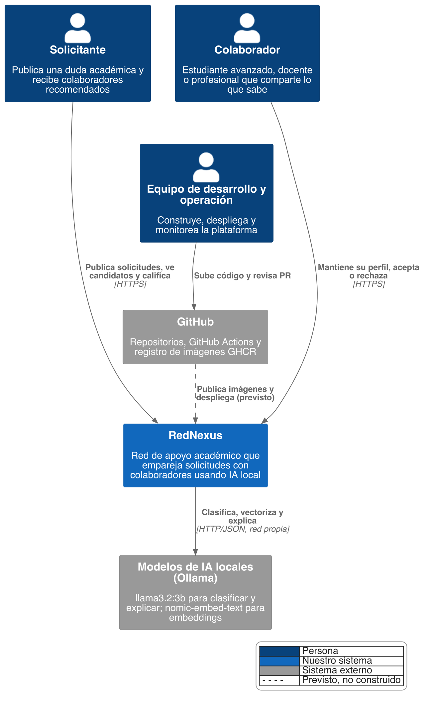

## 2. C4 nivel 2: contenedores

Las piezas que se despliegan por separado. La API y el worker usan **la misma imagen** (`rednexus-api`) con distinto comando.

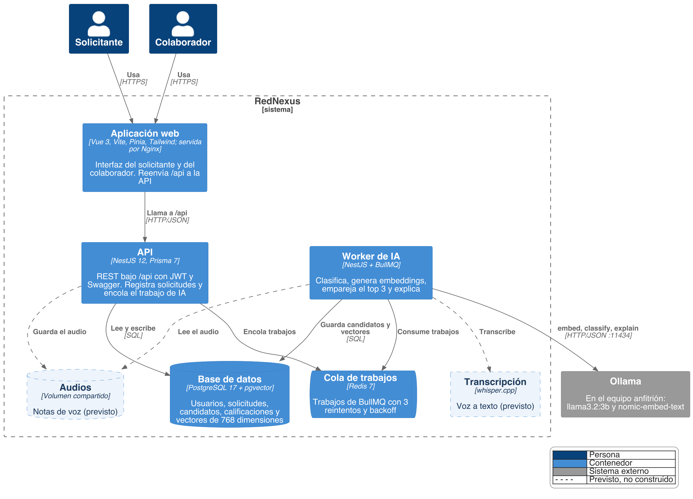

## 3. C4 nivel 3: componentes de la API y del worker

Módulos de NestJS del repo RedNexus-Backend (`src/modules`).

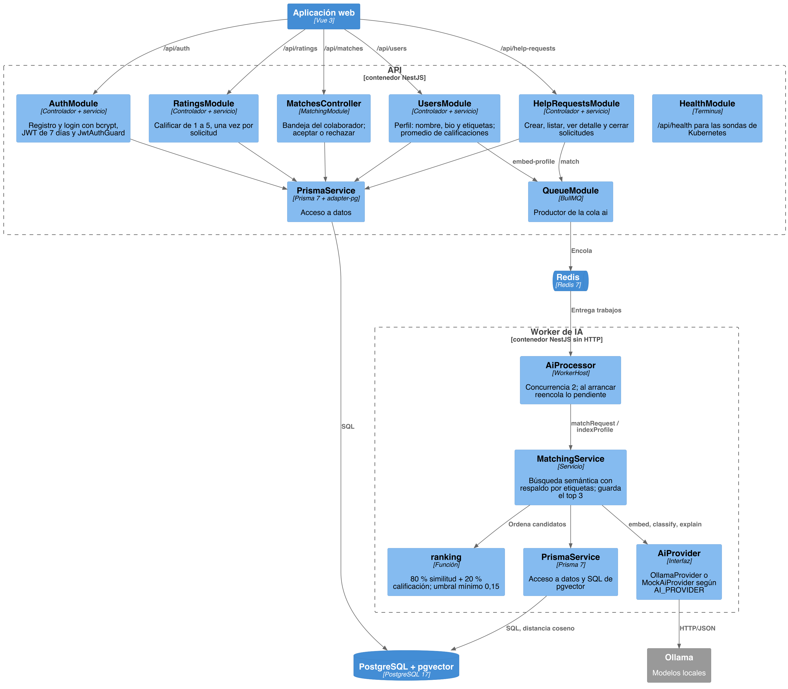

## 4. Vista física (4+1): despliegue local

Lo que hoy levanta `bash scripts/k8s-up.sh [k3d|minikube]`. Ollama corre fuera del clúster para usar la GPU del equipo (Metal en Mac).

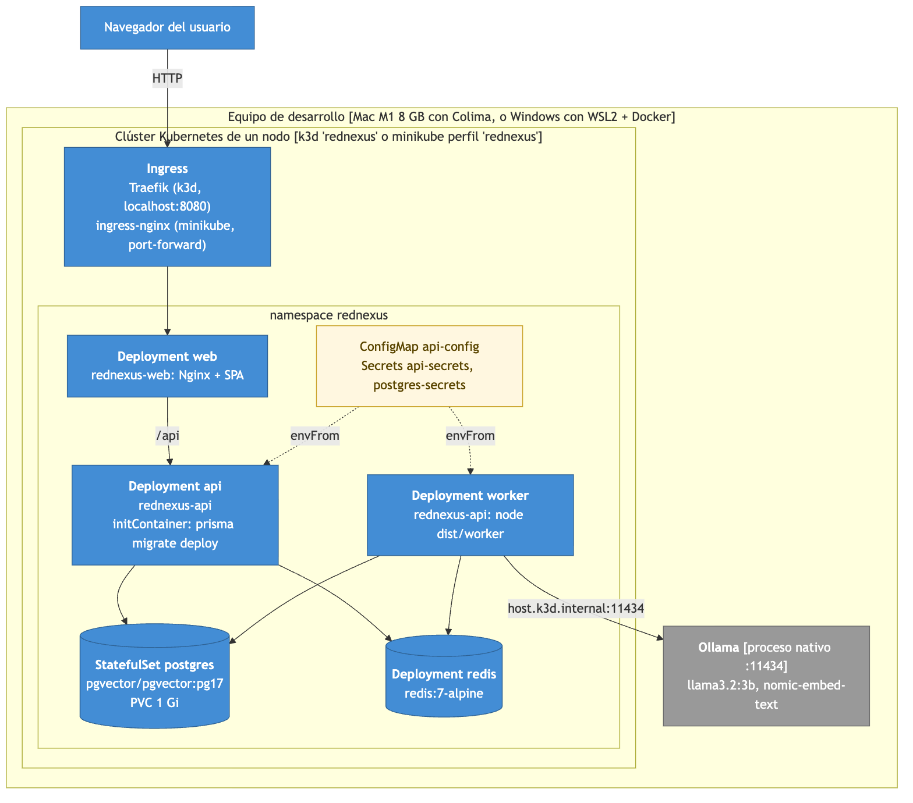

## 5. Vista física (4+1): ambiente de demo y CI/CD

Flujo objetivo de PL-01 a PL-07. **Pendiente decidir** si el ambiente de demo es Dokploy, que es la plataforma compartida que pide el docente, o un clúster con Argo CD (ADR-009).

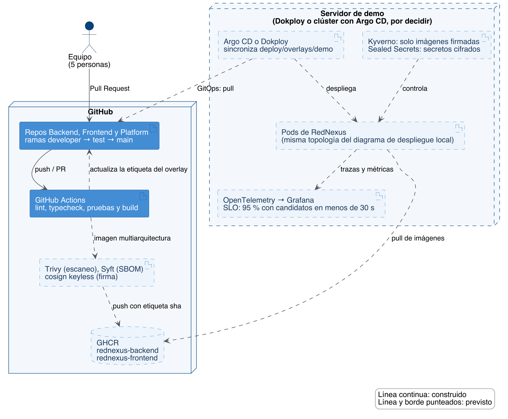

## 6. Modelo entidad-relación

Tomado de `RedNexus-Backend/prisma/schema.prisma`. El detalle de cada campo, su clasificación y su conservación está en el [diccionario de datos](diccionario-de-datos.md).

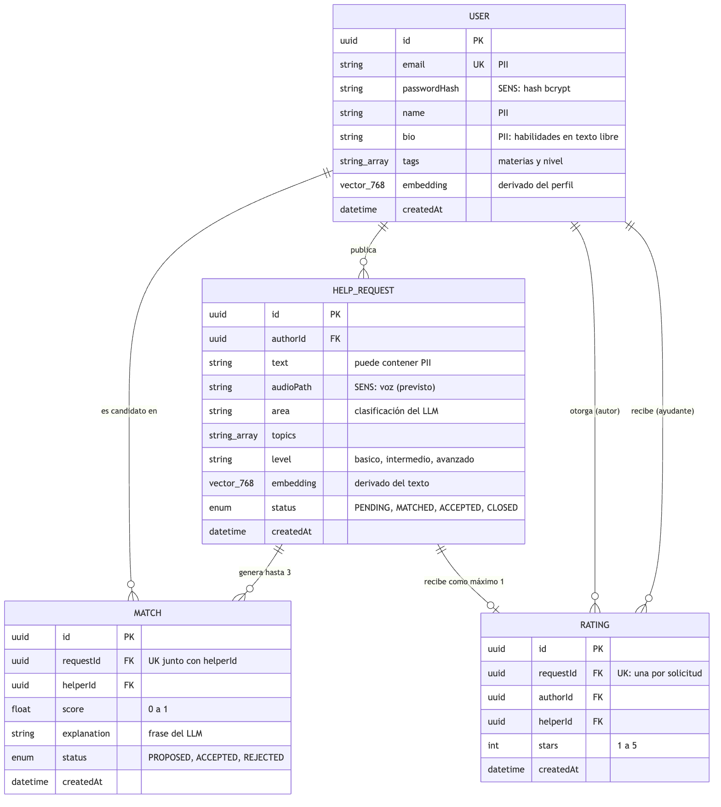

## 7. Casos de uso

En el MVP un mismo usuario puede pedir y dar ayuda: *Solicitante* y *Colaborador* son especializaciones de *Usuario registrado* y heredan sus casos de uso.

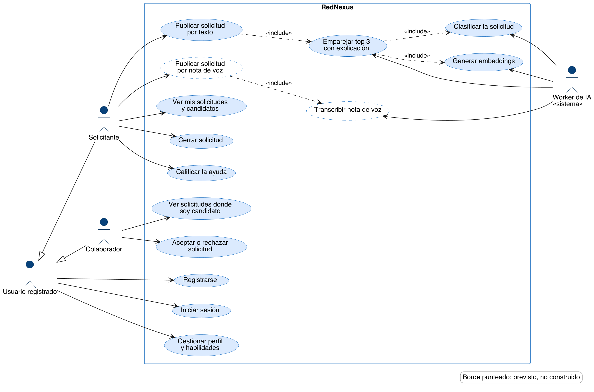

## 8. Secuencia: publicar una solicitud y emparejar con IA

La API responde de inmediato con `PENDING`; el trabajo pesado ocurre en el worker y la web consulta el estado cada 5 segundos (FE-04).

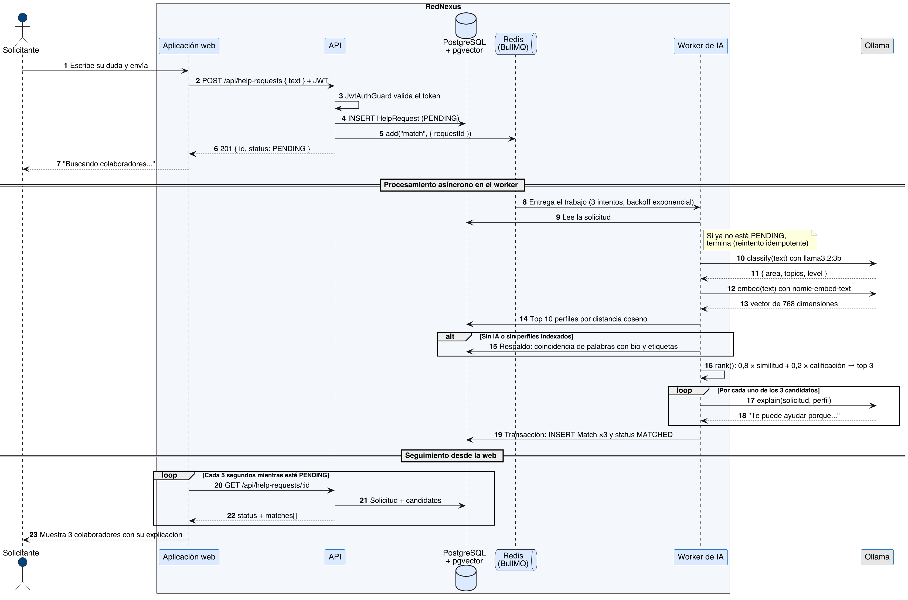

## 9. Secuencia: aceptar la ayuda y calificar

Solo el primer colaborador que acepta se queda con la solicitud; los demás reciben un 409.

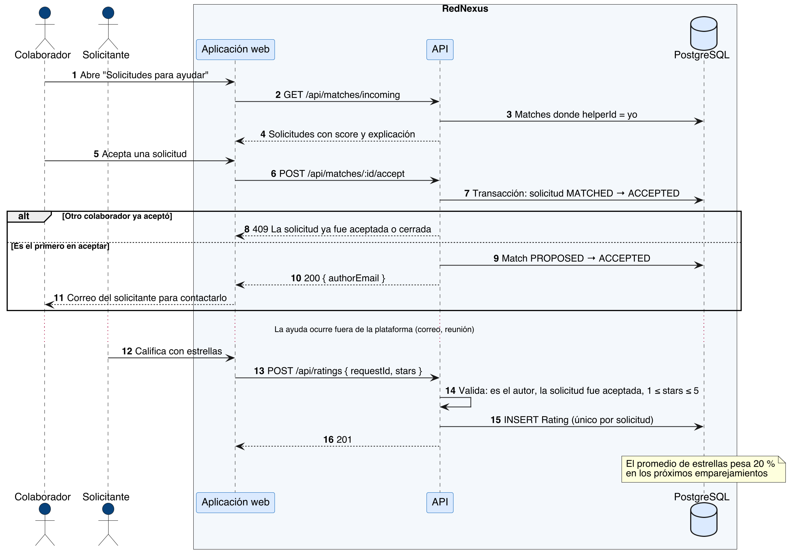

## 10. Actividades: algoritmo de emparejamiento

Lo que hace `MatchingService.matchRequest` en el worker, con sus dos respaldos si la IA no responde.

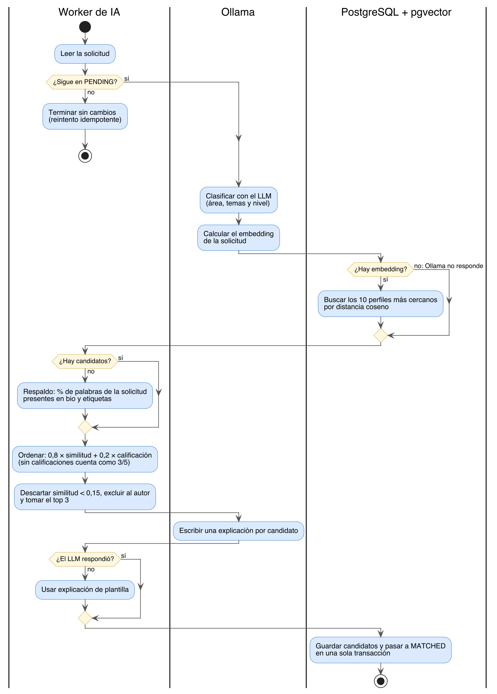

## 11. Estados de la solicitud y del candidato

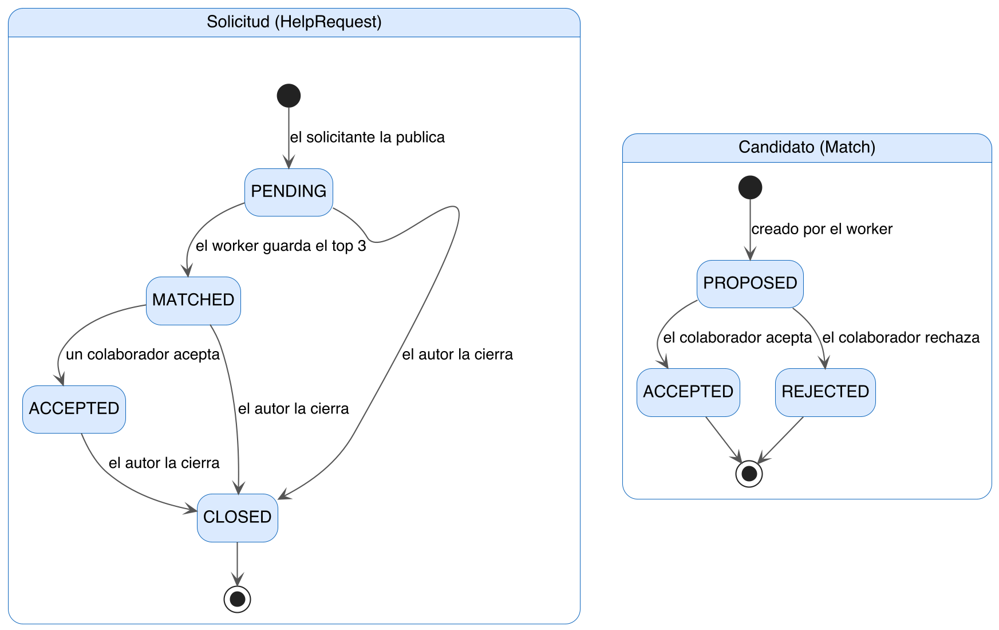
