# Diagramas de arquitectura de RedNexus

Fuente única de los diagramas del documento (DOC-01). Están en [Mermaid](https://mermaid.js.org), así que GitHub los muestra directamente y se pueden editar como texto en los PR.

**Para exportarlos como imagen** (para el documento en Word o la presentación), pega el bloque en https://mermaid.live y descarga PNG o SVG, o desde la raíz de este repo:

```bash
npx -y @mermaid-js/mermaid-cli -i docs/arquitectura/diagramas.md -o salida/diagrama.md -e png -s 2 -b white
```

Genera `salida/diagrama-1.png` a `diagrama-11.png` en el orden de la tabla; cópialos a [img/](img) con el nombre que ya tienen (por ejemplo `01-c4-contexto.png`).

Convenciones C4: azul oscuro = persona, azul = nuestro sistema o contenedor, gris = sistema externo, **línea punteada = previsto, todavía no construido**.

| # | Diagrama | Estado de lo que muestra |
| --- | --- | --- |
| 1 | C4 nivel 1: contexto | Construido, salvo notas de voz |
| 2 | C4 nivel 2: contenedores | Construido, salvo whisper.cpp y el volumen de audios |
| 3 | C4 nivel 3: componentes de la API y el worker | Construido |
| 4 | 4+1 vista física: despliegue local (k3d / minikube) | Construido |
| 5 | 4+1 vista física: despliegue de demo y CI/CD | Previsto (PL-01, PL-03) |
| 6 | Modelo entidad-relación | Construido (migraciones de Prisma) |
| 7 | Casos de uso | Construido, salvo nota de voz |
| 8 | Secuencia: publicar solicitud y emparejar con IA | Construido |
| 9 | Secuencia: aceptar la ayuda y calificar | Construido |
| 10 | Actividades: algoritmo de emparejamiento | Construido |
| 11 | Estados de la solicitud y del candidato | Construido |

---

## 1. C4 nivel 1: contexto del sistema

Quién usa RedNexus y con qué sistemas se relaciona.

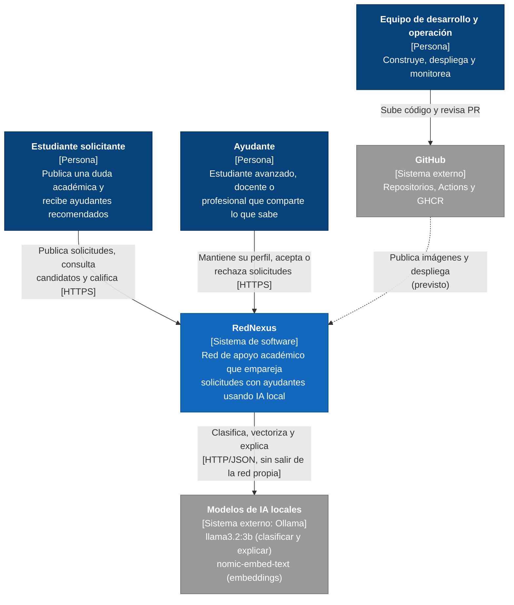

## 2. C4 nivel 2: contenedores

Las piezas que se despliegan por separado. La API y el worker usan **la misma imagen** (`rednexus-api`) con distinto comando.

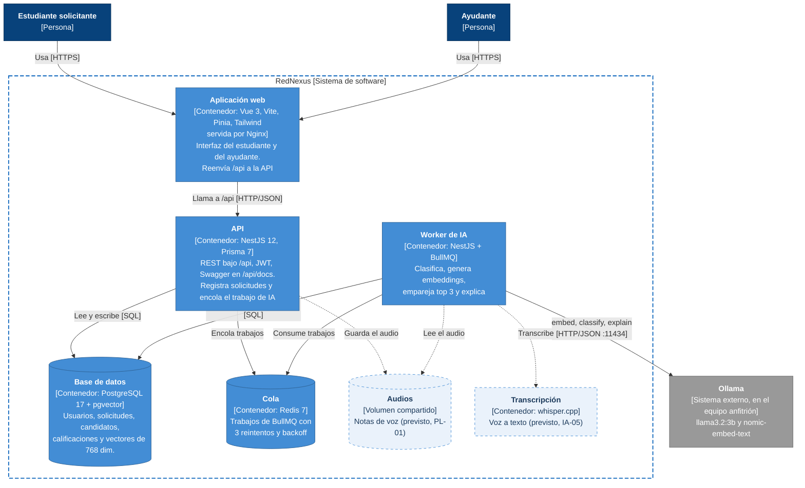

## 3. C4 nivel 3: componentes de la API y del worker

Módulos de NestJS del repo RedNexus-Backend (`src/modules`).

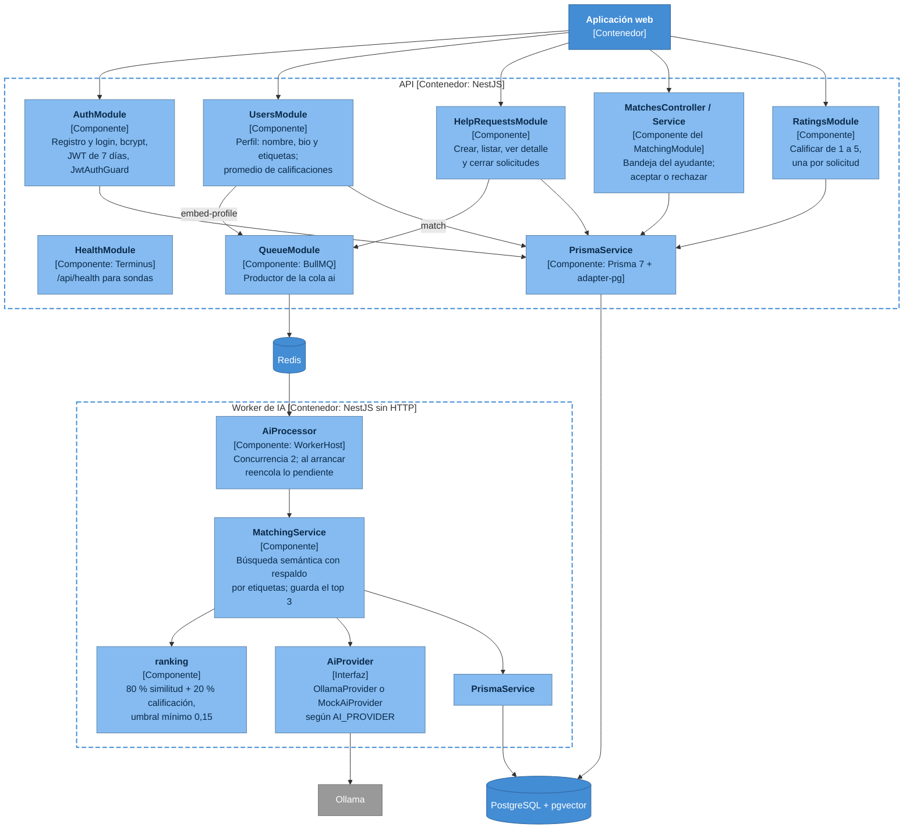

## 4. Vista física (4+1): despliegue local

Lo que hoy levanta `bash scripts/k8s-up.sh [k3d|minikube]`. Ollama corre fuera del clúster para usar la GPU del equipo (Metal en Mac).

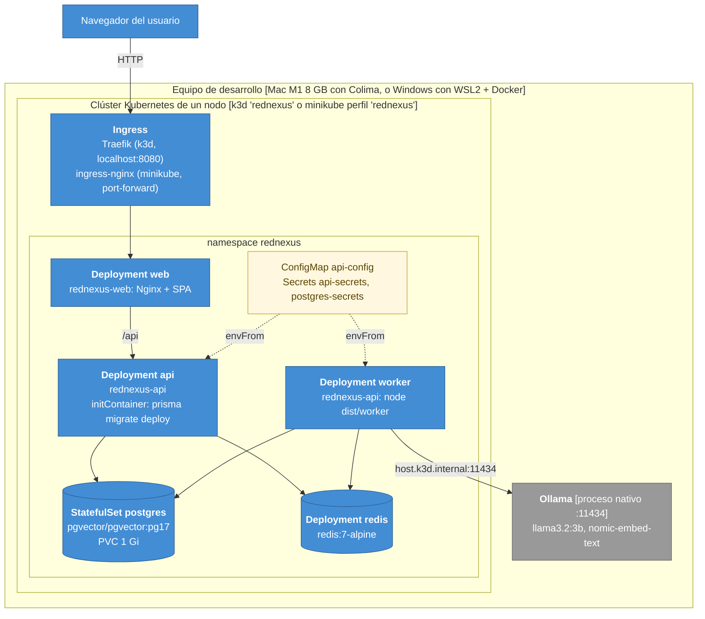

## 5. Vista física (4+1): despliegue de demo y CI/CD (previsto)

Flujo objetivo de PL-01 a PL-05. **Pendiente decidir** si el ambiente de demo es el clúster con Argo CD o la plataforma compartida Dokploy que pide el docente (ver ADR pendiente).

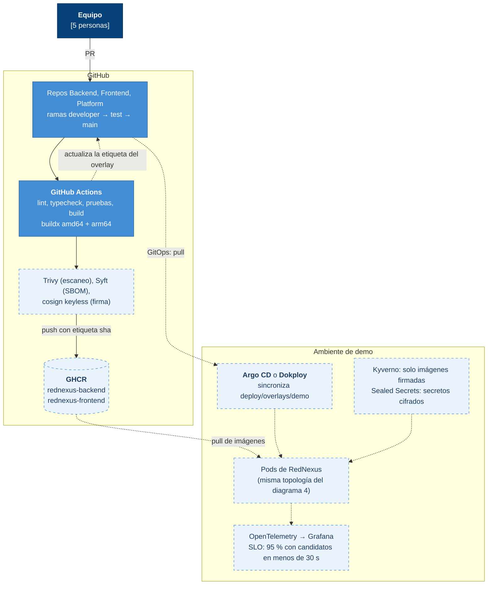

## 6. Modelo entidad-relación

Tomado de `RedNexus-Backend/prisma/schema.prisma`. `PII` = dato personal (Ley 1581 de 2012); `SENS` = dato que requiere protección reforzada.

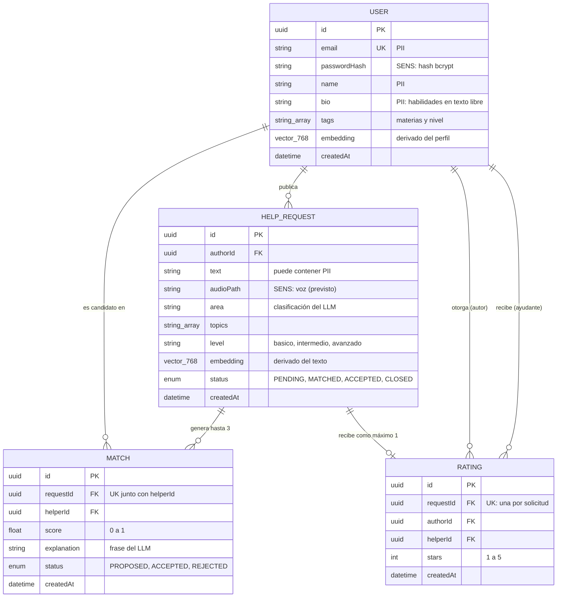

## 7. Casos de uso

En el MVP un mismo usuario puede ser solicitante y ayudante: los dos son especializaciones de *Usuario registrado* y heredan sus casos de uso.

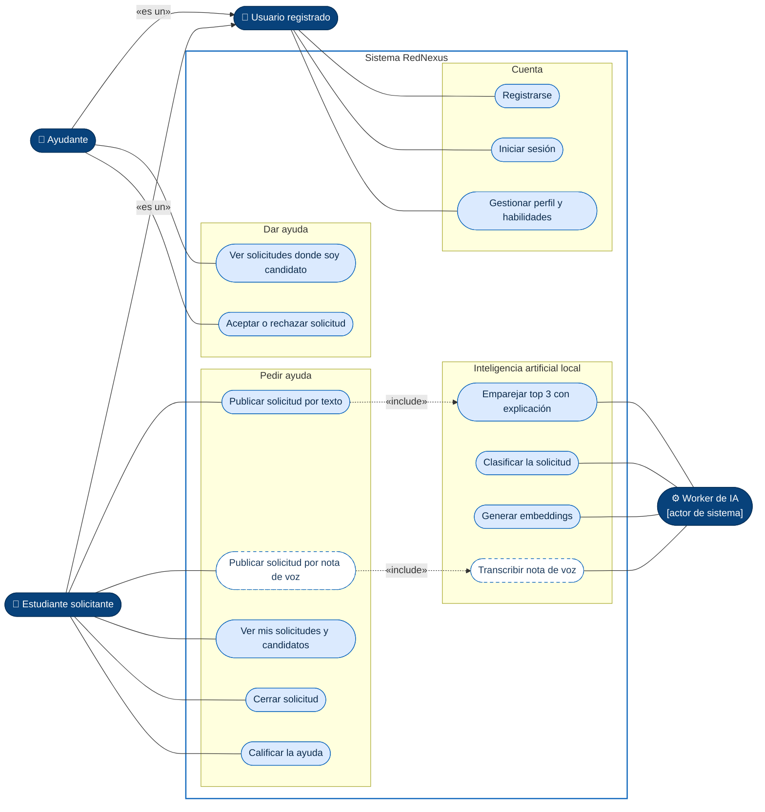

El emparejamiento (uc13) incluye clasificar (uc11) y generar embeddings (uc12); se omiten esas flechas para que el diagrama se lea mejor y se detallan en el diagrama 10.

## 8. Secuencia: publicar una solicitud y emparejar con IA

La API responde de inmediato con `PENDING`; el trabajo pesado ocurre en el worker y el frontend consulta el estado.

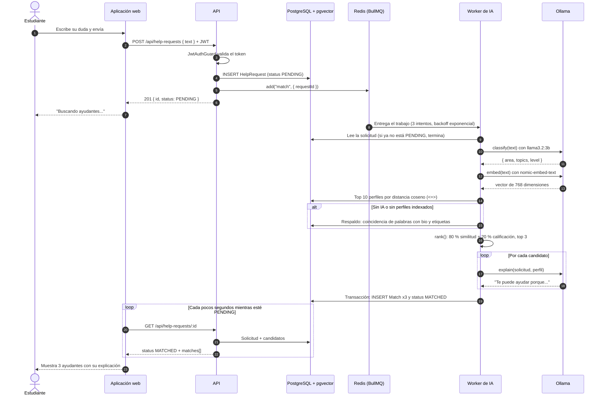

## 9. Secuencia: aceptar la ayuda y calificar

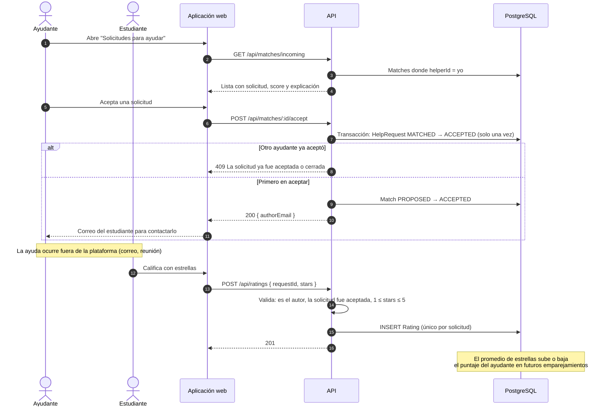

## 10. Actividades: algoritmo de emparejamiento

Lo que hace `MatchingService.matchRequest` en el worker.

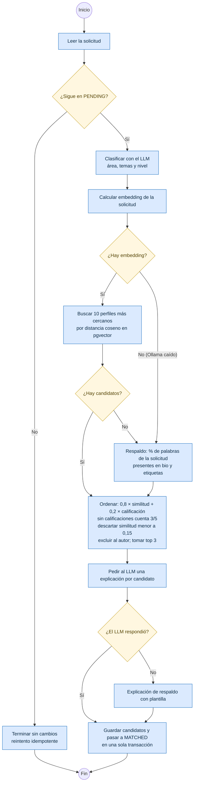

## 11. Estados de la solicitud y del candidato

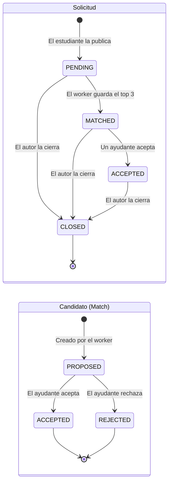
